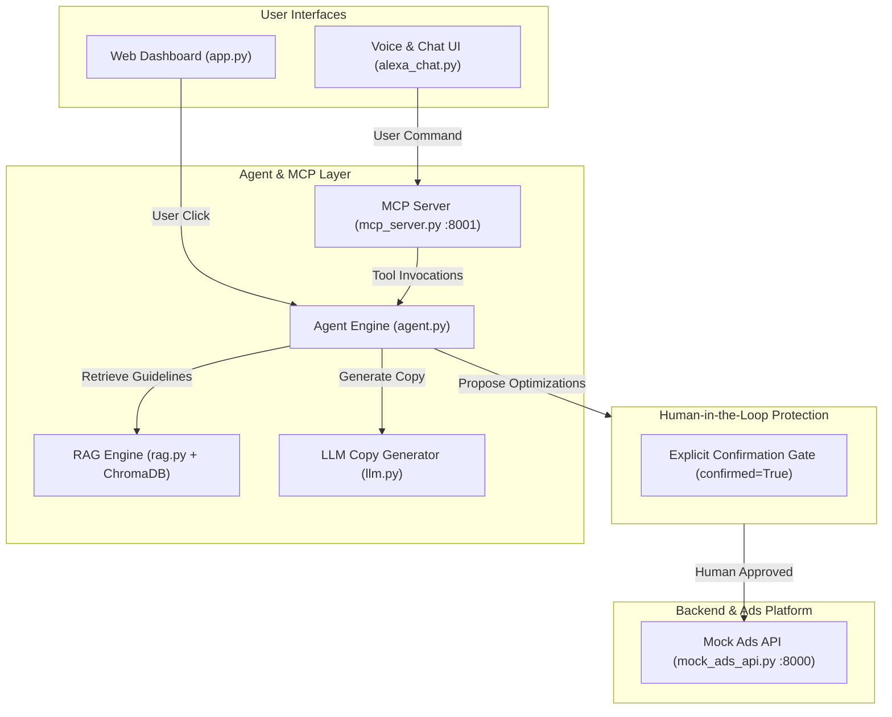

# ✈️ AdPilot — AI In-House Advertising Assistant

> **Hackathon Submission Track:** Alexa+ & Autonomous Agents  
> **Brand Demo:** GreenSip (Eco-friendly water bottle)  
> **Core Guarantee:** Strict Human-in-the-Loop (HITL) safety — **no ad changes or budget updates occur without explicit human approval.**

---

## 📌 Overview

**AdPilot** is an autonomous advertising assistant designed for e-commerce and retail brands. It streamlines the entire ad management lifecycle:
1. **RAG-Guided Ad Creation:** Generates compliant ad copy adhering to brand guidelines indexed in ChromaDB.
2. **Campaign Launch & Tracking:** Creates ads, tracks impressions, clicks, spend, and calculates CTR in real time.
3. **Simulated Traffic Execution:** Advances campaign days to test real-world scenarios without spending real money.
4. **Autonomous Performance Optimization:** Identifies winning and losing ads, formulating actionable recommendations (e.g. boosting top-performing ads or pausing underperformers).
5. **Multi-Modal Interaction:** Features an Alexa-style voice and conversational interface alongside a real-time web dashboard.
6. **Strict Human Approval Gate:** Guarantees that neither an LLM nor an autonomous routine can modify campaign budgets or statuses without an explicit confirmation from a human.

---

## 🏗️ System Architecture



### Safety Model (Defense in Depth)

- **Agent Core (`agent.apply`):** Defaults to `confirmed=False`. Calling `apply()` without explicit confirmation returns a `needs_confirmation` response and blocks any network call. Input validation rejects missing IDs, unsupported actions, or invalid budgets.
- **MCP Server Layer (`apply_optimization` tool):** Enforces `user_confirmed: bool = False`. Unless the parameter is set to `True`, the tool responds with `needs_confirmation`.
- **Alexa / Chat Layer (`alexa_chat.py`):** User intent parsing intercepts confirmation/rejection keywords before invoking any LLM, eliminating prompt-injection or hallucination risks.

---

## ⚡ Current Status & Cloud Credentials

| Component | Status | Details |
| :--- | :---: | :--- |
| **Mock Ads Platform** | 🟢 **OPERATIONAL** | Fast, local REST API running on port 8000 |
| **MCP Server** | 🟢 **OPERATIONAL** | Streamable HTTP server on port 8001 with 5 registered tools |
| **Streamlit Interface** | 🟢 **OPERATIONAL** | Supports both voice and text commands |
| **Brand RAG Vector DB** | 🟢 **OPERATIONAL** | ChromaDB indexed with 9 verified GreenSip guidelines |
| **Human-in-the-Loop Gate** | 🟢 **VERIFIED** | 100% blocked without explicit confirmation |
| **AWS Bedrock** | ⚠️ **BLOCKED (`NOT_AUTHORIZED`)** | AWS account currently lacks Bedrock model access permissions. **Offline fallback mode is active** and generates full ad copy without cloud dependency. |

---

## 🚀 Quickstart Guide (Windows 11 / PowerShell)

### Prerequisites
- Python 3.10+ installed and available on PATH (`py --version`).
- Microphone enabled in Windows settings for voice testing (optional; text input works identically).

### Step 1 — Install Dependencies
Open a PowerShell terminal in the project folder:
```powershell
cd adpilot
py -m pip install -r requirements.txt
```

---

### Step 2 — Start the Services (3 Terminals)

#### Terminal 1 — Start Mock Ads Platform
```powershell
cd adpilot
py -m uvicorn mock_ads_api:app --port 8000
```
*Verify: Open http://127.0.0.1:8000/ads in your browser (should return `[]`).*

#### Terminal 2 — Start the MCP Server
```powershell
cd adpilot
py mcp_server.py
```
*Listens on `http://127.0.0.1:8001/mcp`.*

#### Terminal 3 — Launch the Alexa Voice & Chat UI
```powershell
cd adpilot
py -m streamlit run alexa_chat.py
```
*(Alternative: run the dashboard via `py -m streamlit run app.py`)*

The UI will automatically open at **`http://localhost:8501`**.

---

## 🧪 Verification & Automated Testing

You can run our automated test suites at any time to verify system integrity:

### 1. Test MCP Tools End-to-End
With Terminals 1 and 2 running:
```powershell
py test_mcp.py
```
*Verifies all 5 MCP tools (`launch_campaign`, `campaign_report`, `simulate_days`, `suggest_optimizations`, `apply_optimization`) and checks unconfirmed vs confirmed behavior.*

### 2. Test Human-in-the-Loop Safeguards
```powershell
py test_apply_guard.py
```
*Verifies that:*
- Unconfirmed pauses and budget boosts change zero campaign data.
- Missing ad IDs, negative budgets, and malformed actions are cleanly rejected.
- Confirmed actions successfully apply changes to the ads platform.

---

## 📋 Hackathon Submission Checklist

- [x] **Working Core Agent:** Autonomous generation, simulation, performance reporting, and optimization recommendations.
- [x] **MCP Server Standard:** Standards-compliant Model Context Protocol server exposing real tools.
- [x] **Voice & Multi-modal Interface:** Alexa-like conversational agent with text-to-speech output.
- [x] **Human-in-the-Loop Security:** Hardened multi-layer confirmation architecture.
- [x] **RAG Knowledge Base:** ChromaDB vector storage for brand voice and guideline enforcement.
- [x] **Automated Test Coverage:** End-to-end integration tests and security guard tests.
- [x] **Clean Repository:** Standard `.gitignore` and clear beginner-friendly documentation.
- [!] **AWS Bedrock Authorization:** Documented transparently as `BLOCKED (NOT_AUTHORIZED)` with reliable offline fallback.
